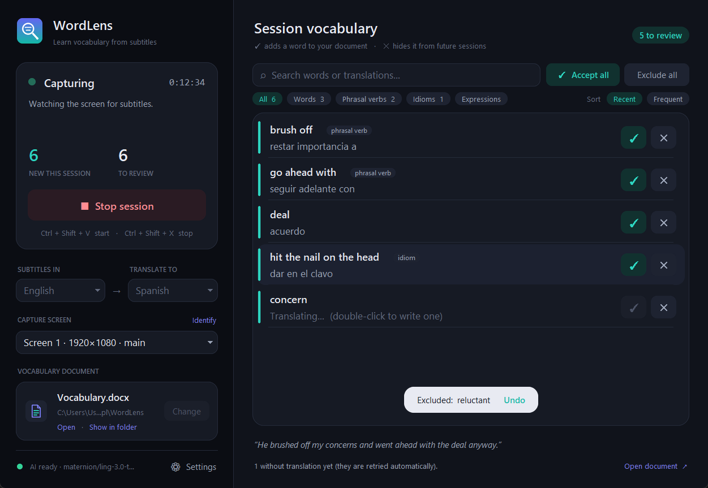

# WordLens

**WordLens reads the subtitles on your screen while you watch a series or film, collects every word and expression in them, translates each one in context, and lets you choose — with ✓ or ✕ — what goes into your Word vocabulary document.**

> **brush off** — restar importancia a
> **go ahead with** — seguir adelante con
> **deal** — acuerdo

It is a normal Windows desktop app: install it, open it from the Start menu, press **Start**, and keep watching. New words appear in the **vocabulary panel** of the main window as they are detected, ready to review. Everything runs on your computer: screen capture, OCR, the AI models (via Ollama), the translations and the document. Nothing is sent to the internet and nothing costs money.




---

## Features

- **Real-time subtitle capture** — reads the top and bottom thirds of the screen every 0.5 s (in memory only, never saved to disk).
- **Capture screen selection** — with two or more monitors, choose the one where the video plays (*Capture screen* in the window; *Identify* shows each screen's number on it). The choice survives disconnecting and reconnecting monitors.
- **OCR** — the native Windows OCR engine (~15–35 ms per band), tuned for white/yellow subtitles.
- **Exhaustive vocabulary extraction** — every lexical unit of each subtitle: nouns, verbs, adjectives, adverbs, slang and insults, phrasal verbs, idioms, collocations and colloquial expressions. **No difficulty filter**: WordLens does not guess what you already know — you decide in the review. Only grammar words (articles, pronouns, prepositions, auxiliaries…), grammar patterns (*I have to*, *going to*), names and OCR noise are left out.
- **Contextual translation, free** — each word or expression is translated with the whole subtitle as context (*deal* → *acuerdo* in a business sentence, *repartir* at a card table) by a local model (`gemma3:4b`, chosen after comparing alternatives). No API, no account, no cost.
- **Vocabulary panel** — always visible in the main window and updated live while you watch: **✓** adds a word to your document, **✕** hides it for good. Each decision can be undone for a few seconds (**Undo** / `Ctrl + Z`); translations are corrected in place (double-click or `E`); filter by type (words, phrasal verbs, idioms, expressions), sort by most recent or most frequent, and review without the mouse (`↑ ↓`, `A`, `X`, `Ctrl + F`). Pending words are kept even if you restart Windows.
- **Dark and light themes** — *Settings → General → Appearance*.
- **Excluded vocabulary** — words you reject are never suggested again; manage the list in *Settings → Excluded vocabulary* (search, restore). Excluding *nail* does not hide *hit the nail on the head*; *give up* and *give in* are different entries.
- **Remembers what you accepted** — an accepted word is never suggested again, even if you later delete it from the document or switch documents.
- **Two language directions** — English subtitles → Spanish translations, or Spanish subtitles → English translations.
- **Automatic deduplication** — a word seen 50 times in a session appears once in the review; `figure out`, `Figure out`, `to figure out` and `figure it out` are the same entry; `get at` and `get out` are not.
- **Word vocabulary document** — one permanent `.docx` you choose; accepted entries are appended at the end with **bold expression** — translation.
- **Safe writing** — atomic saves, rotating backups, every save verified by re-reading the file; if the document is open in Word, accepted entries wait (visibly) and are written automatically, never twice.
- **Global hotkeys** — `Ctrl + Shift + V` to start, `Ctrl + Shift + X` to stop, from any app (configurable).
- **System tray** — keeps working in the background; open, start, stop, change document, settings and exit from the tray icon.

---

## Requirements

| What | Why | Notes |
| --- | --- | --- |
| **Windows 10 (2004+) or 11, 64-bit** | Native OCR, hotkeys, tray | |
| **[Ollama](https://ollama.com/download/windows)** | Runs the AI model locally | Installed separately, once |
| **AI model** `maternion/ling-3.0-tiny:8b` | Vocabulary extraction | ~5.3 GB, downloaded once from inside WordLens (it asks first) |
| **Translation model** `gemma3:4b` (recommended) | Contextual translations | ~3.3 GB, `ollama pull gemma3:4b`. Without it WordLens translates with the extraction model (lower quality) |
| Windows OCR language pack for your subtitle language | Reading subtitles | English is usually already installed; see *Troubleshooting* for Spanish |
| 16 GB RAM recommended | The model uses ~5.5 GB | An NVIDIA GPU makes it faster but is not required |

**Microsoft Word is not required.** WordLens writes the `.docx` file itself. You only need something to *read* it: Word, LibreOffice, WPS, or Google Docs.

Python is **not** required to use the installed app.

---

## Installation

1. Install **Ollama** from <https://ollama.com/download/windows> (or `winget install Ollama.Ollama`).
2. Run **`WordLens-Setup-1.2.0.exe`**.
   - By default it installs for your user only (no administrator rights): `%LOCALAPPDATA%\Programs\WordLens`. You can choose *install for all users* (`C:\Program Files\WordLens`) in the first dialog.
   - Optionally tick *Create a desktop shortcut*.
3. Press the **Windows key**, type **WordLens**, and open it.

**Updating from 1.x:** run the new installer over the old one (close WordLens first or let the installer close it). Your settings, document and data folder are kept. On the first start WordLens copies `config.json` (and any old pending entries) to `backups\migration_<date>\`, creates `vocabulary.db` and registers the entries already in your document as *accepted*, so they are never suggested again. Your document is not modified.

**Uninstall:** *Settings → Apps → Installed apps → WordLens → Uninstall* (or from the Start menu entry). The uninstaller asks whether to also delete WordLens settings and logs. **Your vocabulary document is never deleted.**

---

## First setup

The first time you open WordLens it asks for:

1. **Vocabulary document** — a *folder* and a *file name* (suggested: `Documents\WordLens\Vocabulary.docx`, or `%USERPROFILE%\WordLens\Vocabulary.docx` if Windows *Controlled folder access* protects Documents). WordLens checks it can actually write there before accepting it. You can also pick an existing `.docx`: its content is kept and its entries are used to avoid duplicates.
2. **Subtitle language** — English or Spanish.
3. **Translation language** — Spanish or English (always the other one).

Press **Continue**. That's it — next time WordLens opens straight to the main window with everything remembered.

You can change the languages and the document at any time from the main window (while capture is stopped).

---

## Usage

1. Open **WordLens** from the Start menu.
2. Press **Start** (or `Ctrl + Shift + V` from anywhere).
3. Play your video **with subtitles**, ideally full screen. If you have several monitors, pick the one with the video under **Capture screen** (see below).
4. Minimise or close the window — WordLens keeps working from the **system tray** (the icon may be under the `^` arrow next to the clock).
5. Press **Stop** (or `Ctrl + Shift + X`). WordLens finishes the subtitles it still had to analyse, translates the new words (*Finishing…*) and brings the main window to the front with the vocabulary panel.
6. For each entry press **✓** (add to your document) or **✕** (never suggest it again) — or select it with `↑ ↓` and press `A` / `Enter` or `X` / `Delete`. A bar offers **Undo** for a few seconds (`Ctrl + Z`) before the decision is applied. Double-click a translation (or press `E`) to correct it in place. *Accept all* / *Exclude all* apply to the entries shown (after a confirmation); the search box and the type filters narrow the list; *Sort: Frequent* puts the most repeated words first; hovering an entry shows the subtitle it came from. Close the window at any time: the rest stays pending (the tray menu also shows **Review vocabulary (N)…**).

| Status | Meaning |
| --- | --- |
| ● **Ready** | Waiting for you to press Start |
| ● **Capturing** | Reading subtitles (green dot on the tray icon) |
| ● **Processing** | The AI is analysing new lines; capture continues in parallel |
| ● **Finishing** | After Stop: analysing the remaining subtitles and translating; then the window comes to the front |
| ● **Stopped** | Session finished; press Start for a new one |
| ● **Error** | Something needs attention — the window explains what and offers the fix (e.g. *Download model…*) |

**Tray menu** (right-click the icon): Open WordLens · Start · Stop · Review vocabulary (N)… · Open vocabulary document · Change vocabulary document… · Settings… · Exit.

Closing or minimising the window **never** stops WordLens; only **Exit** in the tray menu does. Opening WordLens again from the Start menu brings back the existing window.

**Capture screen.** WordLens lists the monitors Windows reports: *Screen 1* is the main one, the rest follow from left to right. With a single monitor the choice is fixed; with several, choose the one where the subtitles appear — the subtitle bands (top and bottom thirds) are taken from that screen. Click **Identify** to see each number on its screen. You can change it while capturing (it applies within a second). If the chosen monitor is disconnected, WordLens warns you and captures the main screen meanwhile; when you plug it back in, it returns to it automatically. The list updates by itself when monitors are connected or disconnected.

**Settings** (link at the bottom of the sidebar, or the tray menu): AI model, translation model, appearance (dark / light), hotkeys, notifications, **Excluded vocabulary** (search, restore — restoring only lets the word be suggested again, it does not add it to your document), plus links to the log, the data folder and the advanced `config.json`.

> **Tip:** you can keep the document open in Word, but Word locks the file. Entries you accept meanwhile show *not saved yet* in the review and are written automatically (checked every 15 s) as soon as you close Word — also after restarting WordLens.

**Changing the document.** Accepted and excluded words are global: they are remembered whatever document you use, so switching documents never brings back words you already decided on. WordLens only ever writes into the document currently selected and never modifies or deletes other documents.

### What happens with Ollama

WordLens does not bundle Ollama or the model (they are several GB and are shared with other apps). Instead:

- **Ollama not installed** → the window shows *Error* with a **Get Ollama** link.
- **Ollama installed but not running** → WordLens starts it in the background when you press Start.
- **Ollama closed during a session** → WordLens reconnects and restarts it automatically.
- **Model not downloaded** → *Error* with **Download model…**. WordLens asks for confirmation (it is ~5.3 GB), then shows the download progress, which you can cancel. Nothing is ever downloaded without asking.

The status of the AI is always visible at the bottom of the window.

---

## Where things are stored

| What | Where |
| --- | --- |
| Application (read-only) | `%LOCALAPPDATA%\Programs\WordLens\` (or `C:\Program Files\WordLens\`) |
| Settings — `config.json` | `%LOCALAPPDATA%\WordLens\` |
| Logs — `logs\wordlens.log` (rotated, max ~8 MB) | `%LOCALAPPDATA%\WordLens\logs\` |
| **Vocabulary data** — `vocabulary.db` (words pending review, accepted and excluded vocabulary, unsaved acceptances, subtitles not analysed yet, translation cache) | `%LOCALAPPDATA%\WordLens\` |
| Backups of `vocabulary.db` (last 10, one per start) | `%LOCALAPPDATA%\WordLens\backups\vocabulary\` |
| Document backups (last 10, one per session) | `%LOCALAPPDATA%\WordLens\backups\` |
| Copies made when updating from 1.x (`config.json`, old pending entries) | `%LOCALAPPDATA%\WordLens\backups\migration_<date>\`, `backups\config_<date>.json` |
| **Your vocabulary document** | Wherever you chose, e.g. `D:\Inglés\Series B2-C1.docx` |

WordLens never writes in its installation folder and never puts its own files next to your document.

---

## Troubleshooting

| Problem | Solution |
| --- | --- |
| **"Ollama is not installed"** | Install it from <https://ollama.com/download/windows>, then press Start again. |
| **"Ollama is installed but not responding"** | Open *Ollama* from the Start menu and press Start again. |
| **"Couldn't register the shortcut"** | Another app uses that combination. Change it in *Settings* (e.g. `ctrl+alt+f9`). |
| `Ctrl+Shift+V` no longer pastes without formatting in other apps | Expected while WordLens is open (the hotkey is global). Change it in *Settings* if you use it often. |
| **No subtitles detected** | 1) Open the log (*Settings → Open log*): if there are no "Subtítulo nuevo" lines, the problem is capture/OCR. 2) For subtitles that are not white or yellow, set `"ocr_preprocess": "gray"` in the advanced `config.json`. 3) With several monitors, check **Capture screen** is the one with the video (use *Identify*). |
| **Black capture (Netflix, Disney+, Prime…)** | DRM protection. In Chrome/Edge, disable *Settings → System → Use graphics acceleration* and restart the browser. Local players (VLC, MPC-HC) and YouTube work. |
| **Spanish subtitles not read** | Install the Spanish OCR pack: *Settings → Time & language → Language & region → Add a language → Español (España)*, or in an admin PowerShell: `Add-WindowsCapability -Online -Name "Language.OCR~~~es-ES~0.0.1.0"` (use `en-US` for English). |
| **"Windows is blocking WordLens from writing in this folder"** | Windows Defender *Controlled folder access* protects Documents, Desktop, Pictures… Choose a folder outside them (e.g. `%USERPROFILE%\WordLens` or `D:\Inglés`), or allow `WordLens.exe` in *Windows Security → Virus & threat protection → Ransomware protection → Allow an app through Controlled folder access*. |
| **"…is open in another program. Close it in Word"** | Close the document; accepted entries are written automatically (they stay in the review marked *not saved yet* until then). |
| **"Translation pending…" in the review** | The translation model was not available. Check Ollama is running and `gemma3:4b` is installed (`ollama pull gemma3:4b`); they are retried automatically. |
| **Finishing takes a while** | On a 4 GB GPU extraction takes ~2 s per subtitle and runs during the session; after Stop only what is left is analysed, then the translations (~4 s per subtitle). No subtitle is dropped: if you exit, the remaining work continues next time. |
| **"The vocabulary database was damaged"** | WordLens sets the damaged file aside (`vocabulary.damaged_*.db`, never deleted) and restores the latest backup from `backups\vocabulary\`. |

---

## Development

Requires Python 3.10+ (developed with 3.14) on Windows.

```bash
python -m venv .venv
```

```bash
.venv\Scripts\python.exe -m pip install -r requirements-dev.txt
```

Run from source (window + tray, log also printed to the console):

```bash
.venv\Scripts\python.exe main.py
```

Other options: `--start` (start capturing immediately), `--hidden` (tray only), `--document PATH`, `--no-gui` (hotkeys only, Ctrl+C to quit), `-v` (debug log), `--self-test`.

**Development vs production data.** From source, WordLens stores its settings and logs in `.devdata\` inside the project (git-ignored), so it never touches the installed app's data in `%LOCALAPPDATA%\WordLens`. `WORDLENS_DATA_DIR` overrides the data folder for both. `start_wordlens.bat` launches the source version without a console.

**Tests** (the `llm` ones use the real model through Ollama):

```bash
.venv\Scripts\python.exe -m pytest -m "not llm"
```

```bash
.venv\Scripts\python.exe -m pytest
```

They cover exhaustive extraction (the required examples, phrasal verbs, idioms, slang, names, OCR errors, case and punctuation, repeated candidates, no difficulty filter, no free word combinations), contextual translation (parsing, invented words, fallback, engine changes, cost-zero checks), the vocabulary store (dedup of 50 occurrences, exclusions of single words vs. whole expressions, *give up* ≠ *give in*, restore, acceptance precedence, persistence, damaged-database recovery), the review flow end to end with a real `.docx` (Stop → finish → review, ✓ to Word, ✕ to the exclusion list, locked documents with real Windows locks, uncertain writes not duplicated, other documents untouched, bulk actions with partial failures, Ollama down, crash recovery), migration from 1.1 data, the vocabulary panel (live updates, undo, keyboard, inline editing, filters, themes) and the excluded-vocabulary dialog with real Tk widgets, real OCR on synthetic subtitle images (noise, gradients, yellow text, two lines, clocks, side text, Spanish), real screen capture, subtitle stability and history, language filtering, normalisation and deduplication for both languages, broken LLM JSON, vocabulary validation, cognates, the Word writer (existing documents, corrupt files, Word locks, backups, pending recovery), the state machine, global hotkeys fired with real key presses, Ollama status detection, settings and data-folder isolation, several items per subtitle (scripted model and real model: 0, 1, 2, 3 and 4 items, no basic words), capture screen selection (one, two and three screens, disconnection and reconnection, and real OCR on each connected monitor), and the real model.

**Developer tools:**

```bash
.venv\Scripts\python.exe tools\try_text.py "He brushed off my concerns and went ahead with the deal."
```

```bash
.venv\Scripts\python.exe tools\subtitle_simulator.py
```

```bash
.venv\Scripts\python.exe tools\diagnose.py
```

`try_text.py` shows the candidates and translations for sentences with the real models (it writes nothing); `subtitle_simulator.py` shows full-screen fake subtitles (with `--file`, one per line, `top:` prefix for the top band; `--screen 2` to use another monitor) to test the whole chain; `diagnose.py` checks every component.

**Benchmarks** (real models; results of 1.2 in `docs/benchmarks/`, analysis in [`docs/evaluacion-1.2.md`](docs/evaluacion-1.2.md)):

```bash
.venv\Scripts\python.exe tools\benchmark_exhaustive.py --details
```

```bash
.venv\Scripts\python.exe tools\benchmark_translation.py --engine ollama:gemma3:4b --details
```

`benchmark_exhaustive.py` — 50 subtitles with 124 expected lexical units (`tests/benchmark/exhaustive_cases.jsonl`): recall, precision, forbidden items, duplicates; `--impl DIR` scores another copy of the code (e.g. 1.1) the same way. `benchmark_translation.py` — 80 subtitles, 117 units with reviewed reference translations (`tests/benchmark/translation_cases.jsonl`); engines `ollama:<model>`, `argos`, `mymemory`. `benchmark_extraction.py` is the 1.1 benchmark (selective B2+ extraction), kept for reference.

`WORDLENS_CAPTURE_VISIBLE=1` lets screenshot tools see WordLens' own windows (normally they are hidden from screen capture so WordLens doesn't read its own interface as a subtitle).

---

## Build

One command builds everything from scratch — virtual environment, tests, icon, executable, a self-test of the packaged executable, and the installer:

```bash
powershell -ExecutionPolicy Bypass -File build.ps1
```

Requires [Inno Setup 6](https://jrsoftware.org/isinfo.php) for the installer step (`winget install JRSoftware.InnoSetup`). Options: `-SkipTests`, `-SkipInstaller`.

| Output | Location |
| --- | --- |
| Application folder (runnable as is) | `dist\WordLens\WordLens.exe` |
| Installer (~30 MB) | `dist\installer\WordLens-Setup-<version>.exe` |

Steps it runs (each can be run by hand):

```bash
.venv\Scripts\python.exe tools\make_icon.py
```

```bash
.venv\Scripts\python.exe -m PyInstaller packaging\wordlens.spec --noconfirm --distpath dist --workpath build
```

```bash
dist\WordLens\WordLens.exe --self-test
```

```bash
"%LOCALAPPDATA%\Programs\Inno Setup 6\ISCC.exe" /DAppVersion=1.2.0 packaging\installer.iss
```

The version comes from `wordlens/__init__.py`. Silent install for automation: `WordLens-Setup-1.2.0.exe /VERYSILENT /CURRENTUSER`; silent uninstall: `"%LOCALAPPDATA%\Programs\WordLens\unins000.exe" /VERYSILENT`.

### Packaging choices

- **PyInstaller, folder mode** (not one-file): starts instantly (one-file unpacks everything to `%TEMP%` on every launch) and triggers far fewer antivirus false positives. Only the English/Spanish word-frequency lists are bundled (all languages would add ~55 MB).
- **Inno Setup** classic installer: Start-menu entry with icon and AppUserModelID (so Windows search, the taskbar and notifications all show *WordLens*), uninstaller in *Installed apps*, per-user install without admin rights by default, and it closes a running WordLens before updating.
- **Not MSIX**: it needs code signing, and its sandbox gets in the way of what WordLens does (screen capture, global hotkeys, writing documents anywhere). Not targeting the Microsoft Store.
- **Ollama stays external** (see above): bundling it plus a 5 GB model would make a huge installer and duplicate what Ollama already manages well.

---

## How it works

```text
Start ─▶ every 0.5 s: capture top 33 % and bottom 33 % of the chosen screen (memory only)
            ▼
         Preprocess: isolate white/yellow text (subtitle colours)
            ▼
         Windows OCR (en-US / es-ES)          ~15–35 ms per band
            ▼
         Looks like a subtitle?  centred, ≥2 words, in the subtitle language, not a clock/menu
            ▼
         New?  seen in 2 consecutive frames, not processed in the last 3 min
            ▼  only new text
         Saved in vocabulary.db (lines)  ── nothing is dropped, even if the AI is slow or down
            ▼  analysed in the background, one subtitle per call
         Extraction model (ling, Ollama): every expression + content word, dictionary form, type
         + rules: every content word of the line (safety net for what the model skips)
            ▼
         Deterministic validation: must be in the subtitle; no grammar words, grammar
         patterns ("have to"), names, non-words or whole sentences. NO difficulty filter.
         Words inside a detected phrasal verb/idiom are not repeated.
            ▼
         Already accepted / excluded / in the document?  (normalised entry key)
            ▼  new ones (a repeated one just counts +1)
         candidates (pending review)
  Stop ─▶ finish the remaining subtitles ─▶ translate new candidates with gemma3:4b,
         whole subtitle as context ─▶ vocabulary panel (live)
            ▼
         ✓ → accepted (pending write) → written to the .docx, re-read, confirmed
         ✕ → excluded (never suggested again; Settings › Excluded vocabulary)
```

WordLens' own windows are excluded from screen capture (`WDA_EXCLUDEFROMCAPTURE`), so its interface is never mistaken for a subtitle.

### Technical decisions

Measured on the development machine: i7-11800H, 16 GB RAM, RTX 3050 Ti Laptop (4 GB), Windows 11, Ollama 0.40.

**AI model — `maternion/ling-3.0-tiny:8b`.** Mixture-of-Experts, 7.9 B total / 1.3 B active parameters per token, 5.3 GB (Q4_K_M). On a 4 GB GPU, ~42 % runs on the GPU and the rest on CPU. Thanks to Ollama's prefix cache (the fixed ~560-token prompt is reused) a line takes **~1 s** including any expressions found; the first load takes ~40–80 s and is done when the session starts. Good at phrasal verbs, idioms and advanced words and at lemmatising; weak points are proposing basic words or cognates (filtered deterministically) and occasional imprecise translations. Compared with the same prompt: `qwen3.5:4b` was slightly more precise but slower; `mistral 7B` translated worse ("estar bajo mi piel"). Any Ollama model can be selected in *Settings*.

**Exhaustive extraction and review (1.2).** WordLens no longer guesses what you know: it proposes every lexical unit and you decide with ✓ / ✕. The 1.1 prompt asked only for "upper-B2/C1/C2" items and the validator dropped frequent words, cognates and "trivial" combinations — on an exhaustive benchmark (50 subtitles, 124 expected units, same `ling` model) 1.1 found 33 (recall 0.27), 1.2 finds 119 (**recall 0.96, precision 0.95**, 46/50 subtitles complete, ~2 s per subtitle). The model now only identifies (no translation, a `type` field), rules add every content word it skips, and translation is a separate step. Full analysis: [`docs/evaluacion-1.2.md`](docs/evaluacion-1.2.md).

**Translation — `gemma3:4b`, local (1.2).** Compared on 117 units in 80 subtitles (polysemy, phrasal verbs, idioms, slang, collocations, negation, irony) against reviewed references: gemma3:4b 83.8 % automatic / ~91–93 % after manual review, ling 75.2 %, mistral:7b 66.7 %, qwen2.5:3b 55.6 %, MyMemory 44.4 %, Argos Translate 28.2 % (the last two cannot use context: *brush off* → "cepillo apagado"). Google Cloud Translation, DeepL API and Azure Translator were ruled out because they require billing or a credit card. gemma3:4b runs in Ollama on this PC: no account, key, card, quota or network — it cannot cost anything. Translations run after Stop (so they don't compete with extraction on a 4 GB GPU), are cached per (unit, subtitle, engine) and regenerate automatically if the engine or prompt changes. Options with words that don't exist in Spanish are discarded; anything gemma can't translate is retried with the extraction model.

**Vocabulary state — SQLite (1.2).** `vocabulary.db` (Python's built-in `sqlite3`, no new dependency) is the single source of truth: subtitles not yet analysed, pending candidates, accepted entries with their write state, exclusions and the translation cache. Every decision is one transaction, so an entry is never in two states or in none. The Word document is not the memory any more: deleting a line from it does not bring the word back. Entry identity (`entry_key`) ignores case, spacing, punctuation, leading articles, object pronouns and plural/inflection of single words, and compares the **whole** unit: excluding *nail* does not affect *hit the nail on the head*, *brush off* does not affect *brush* or *brush up on*, and *give up* ≠ *give in*.

**Vocabulary extraction — several items per subtitle (1.1).** In 1.0 the small model usually returned only the *first* interesting item of a line, and a malformed JSON answer lost the whole line. Nothing after the model was cutting the list; the cause was the model itself and the prompt ("be conservative", single-item examples). 1.1 changes four things, each measured:

1. A prompt that asks for *every* item at upper-B2/C1/C2 level, with examples of 0, 1, 2 and 3 items per line and of what to skip.
2. Candidates found without AI (less common words by `wordfreq` frequency, verb + particle pairs) sent next to each line as a checklist; the model still decides.
3. A second look, only when needed, at less common words the model did not evaluate (it sometimes answers `[]` for a line with clearly advanced words).
4. Recovery of every complete item from broken JSON, intensifier removal ("incredibly tacky" → "tacky"), names and non-words rejected, invented "cognate" translations dropped, longest overlapping unit kept.

Benchmark (`tools/benchmark_extraction.py`, 61 annotated sentences with 84 expected items, same model `ling-3.0-tiny:8b`):

| Lines per AI call | Version | Found | Missed | False positives | Precision | Recall | Multi-item sentences complete | …with only 1 found | FP on basic sentences |
| --- | --- | --- | --- | --- | --- | --- | --- | --- | --- |
| 1 | 1.0 | 47 | 37 | 7 | 0.87 | 0.56 | 0 / 26 | 21 | 6 |
| 1 | **1.1** | **72** | **12** | **4** | **0.95** | **0.86** | **19 / 26** | **2** | **0** |
| 2 | 1.0 | 52 | 32 | 12 | 0.81 | 0.62 | 4 / 26 | 14 | 9 |
| 2 | **1.1** | **74** | **10** | **11** | **0.87** | **0.88** | **18 / 26** | **3** | **2** |
| 4 | 1.0 | 50 | 34 | 18 | 0.74 | 0.60 | 4 / 26 | 11 | 8 |
| 4 | **1.1** | **69** | **15** | **6** | **0.92** | **0.82** | **18 / 26** | **5** | **1** |

Contribution of each part (1 line per call): new prompt only 0.63 recall → + candidates 0.77 → + second look 0.86. Translations judged correct: 0.88–0.94 in 1.1 vs 0.92–0.94 in 1.0 (keyword check against accepted Spanish equivalents; 1.1 translates many more items, including harder ones). Latency per line: ~1.3 s, as before.

The gain does not depend on the model: with the same benchmark, `gemma3:4b` goes from 0.50 to 0.87 recall (best translations, 0.99, but 5 s per line), `qwen2.5:3b` from 0.34 to 0.77 and `mistral:7b` from 0.49 to 0.80. **No fine-tuning**: prompt + processing already fix the problem for every model tested, and training an 8 B model is not practical on a 4 GB laptop GPU; the remaining misses are mostly single domain words (*merger*, *aides*) and partial idioms.

**Ollama connection.** The client connects to `127.0.0.1` rather than `localhost`: on Windows, `localhost` tries IPv6 first and every request paid a ~2 s timeout before falling back. This alone cut start-up from ~5 s to instant and every LLM call by ~2 s.

**OCR — Windows.Media.Ocr.** Built into Windows, no binaries or models to install, 15–35 ms per band with preprocessing, very accurate on large clean text. Tesseract needs an external install and does worse on video; EasyOCR/PaddleOCR need multi-GB frameworks and are slow on CPU. Isolating bright white/yellow pixels removes the video background: in tests OCR went from 170 ms with errors to 16 ms with exact text.

**Capture — mss.** GDI BitBlt via ctypes, ~5–20 ms per band. Only the top and bottom thirds are captured; unchanged bands (paused video) skip OCR entirely.

**Word — python-docx.** No Word installation needed. Atomic writes, rotating backups, re-reading before each write (so manual edits are respected).

**Hotkeys — RegisterHotKey (Win32).** No admin rights, no keyboard hook (it does not see your other key presses), and Windows reports conflicts.

**Interface — tkinter + pystray.** Both already part of the stack (no new heavy dependency such as Qt, ~100 MB). Tk runs on the main thread; the tray runs its own message loop; everything else talks to the window through a thread-safe queue.

**Long sessions.** Capture/OCR never wait for the model (separate threads); subtitles waiting for the model are stored in `vocabulary.db` instead of an in-memory queue, so none is dropped and they survive a crash; subtitle history is bounded (3 min, 500 entries); images are never kept or saved.

### Architecture

```text
WordLens/
├── main.py                       # Entry point: logging, single instance, hotkeys, window + tray
├── build.ps1                     # Builds everything: tests → exe → self-test → installer
├── packaging/
│   ├── wordlens.spec             # PyInstaller
│   └── installer.iss             # Inno Setup
├── assets/                       # wordlens.ico / wordlens.png (generated by tools/make_icon.py)
├── wordlens/
│   ├── app.py                    # Controller: sessions, capture/analyzer/finisher threads, SaveWorker (✓ → Word)
│   ├── state.py                  # State machine INACTIVE/CAPTURING/PROCESSING/FINISHING/STOPPED
│   ├── migration.py              # 1.x → 1.2 data migration (backups first, idempotent)
│   ├── selftest.py               # --self-test for the packaged app
│   ├── capture/                  # Screen bands, monitors (capture screen), preprocessing, change detection, subtitle filter
│   ├── ocr/ocr_engine.py         # Windows.Media.Ocr
│   ├── ai/
│   │   ├── ollama_client.py      # Ollama REST API (cancellable, model pull)
│   │   ├── ollama_setup.py       # Find / start Ollama, check the model
│   │   ├── prompts.py            # Exhaustive extraction prompts and examples (EN, ES)
│   │   └── vocabulary_analyzer.py # Model + rules → consolidated candidates
│   ├── translation/translator.py # Contextual translation engine (gemma3:4b via Ollama), replaceable
│   ├── vocabulary/
│   │   ├── lexicon.py            # Content words, grammar words/patterns, careful lemmas
│   │   ├── extractor.py          # Parse model output, validate candidates
│   │   ├── normalization.py      # entry_key: identity of an entry
│   │   ├── store.py              # vocabulary.db (SQLite): pending, accepted, excluded, lines, cache
│   │   └── candidates.py, languages.py, models.py
│   ├── document/word_writer.py   # Safe .docx reading/writing
│   ├── input/hotkeys.py          # RegisterHotKey
│   ├── ui/
│   │   ├── window.py             # Main window, first setup, settings
│   │   ├── review.py             # Review window (virtual list) and Excluded vocabulary dialog
│   │   ├── tray.py               # Tray icon and menu
│   │   └── icon.py               # Icon drawing
│   └── config/
│       ├── paths.py              # App files vs user data (production / development)
│       └── settings.py           # config.json
├── tools/                        # try_text, subtitle_simulator, diagnose, benchmarks, make_icon
├── docs/                         # evaluacion-1.2.md + benchmark results
└── tests/                        # pytest; benchmark/*.jsonl = annotated benchmarks
```

### Known limitations

- **DRM video** may be captured black (see *Troubleshooting*).
- **Translation quality**: about 9 in 10 translations are right in the benchmark; the rest are mostly irony and rare idioms. Double-click a translation in the review to correct it before accepting.
- **Many suggestions at first**: with no difficulty filter, the first sessions propose basic words too (*go*, *know*, *movie*). Exclude them once with ✕ (or *Exclude all* after accepting what you want) and they never come back.
- **Extraction misses**: about 4 % of units in the benchmark (e.g. *at the last minute* comes out as *last* + *minute*), plus occasional free combinations labelled as collocations (*grab an umbrella*).
- **Names at the start of a sentence** are only recognised if the model reports them, if they appeared capitalised elsewhere in the session, or if they are common first names.
- **Screen numbers** follow WordLens' own order (main screen first, then left to right), which may differ from the numbers in Windows Settings — use *Identify*.
- **Small GPUs**: extraction takes ~2 s per subtitle; in very fast dialogue the analysis falls behind and finishes after Stop (nothing is dropped), so the review may take a minute or two to open.
- **Unusual subtitle colours**: use `"ocr_preprocess": "gray"`.
- **Windows only** (native OCR, hotkeys and capture exclusion).
