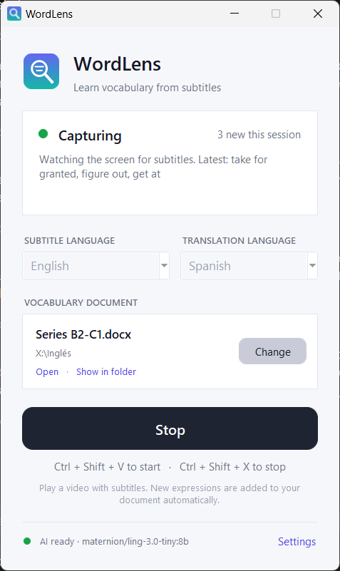

# WordLens

**WordLens reads the subtitles on your screen while you watch a series or film, picks out the vocabulary worth learning, and adds it — translated — to a Word document.**

> **figure out** — averiguar / descubrir
> **take for granted** — dar por sentado
> **overwhelmed** — abrumado / sobrepasado

It is a normal Windows desktop app: install it, open it from the Start menu, press **Start**, and keep watching. Everything runs on your computer: screen capture, OCR, the AI model (via Ollama) and the document. Nothing is sent to the internet.



---

## Features

- **Real-time subtitle capture** — reads the top and bottom thirds of the screen every 0.5 s (in memory only, never saved to disk).
- **OCR** — the native Windows OCR engine (~15–35 ms per band), tuned for white/yellow subtitles.
- **Local AI vocabulary extraction** — a local LLM (Ollama) finds phrasal verbs, idioms, collocations and advanced words at B2–C1 level, using the full sentence as context.
- **Translation** — each expression gets a short translation for its meaning *in that context*.
- **Two language directions** — English subtitles → Spanish translations, or Spanish subtitles → English translations.
- **Automatic deduplication** — `figure out`, `Figure out`, `to figure out` and `figure it out` are the same entry; `get at` and `get out` are not.
- **Word vocabulary document** — one permanent `.docx` you choose; new entries are appended at the end with **bold expression** — translation.
- **Safe writing** — atomic saves, rotating backups, and nothing is lost if the document is open in Word.
- **Global hotkeys** — `Ctrl + Shift + V` to start, `Ctrl + Shift + X` to stop, from any app (configurable).
- **System tray** — keeps working in the background; open, start, stop, change document, settings and exit from the tray icon.

---

## Requirements

| What | Why | Notes |
| --- | --- | --- |
| **Windows 10 (2004+) or 11, 64-bit** | Native OCR, hotkeys, tray | |
| **[Ollama](https://ollama.com/download/windows)** | Runs the AI model locally | Installed separately, once |
| **AI model** `maternion/ling-3.0-tiny:8b` | Vocabulary analysis | ~5.3 GB, downloaded once from inside WordLens (it asks first) |
| Windows OCR language pack for your subtitle language | Reading subtitles | English is usually already installed; see *Troubleshooting* for Spanish |
| 16 GB RAM recommended | The model uses ~5.5 GB | An NVIDIA GPU makes it faster but is not required |

**Microsoft Word is not required.** WordLens writes the `.docx` file itself. You only need something to *read* it: Word, LibreOffice, WPS, or Google Docs.

Python is **not** required to use the installed app.

---

## Installation

1. Install **Ollama** from <https://ollama.com/download/windows> (or `winget install Ollama.Ollama`).
2. Run **`WordLens-Setup-1.0.0.exe`**.
   - By default it installs for your user only (no administrator rights): `%LOCALAPPDATA%\Programs\WordLens`. You can choose *install for all users* (`C:\Program Files\WordLens`) in the first dialog.
   - Optionally tick *Create a desktop shortcut*.
3. Press the **Windows key**, type **WordLens**, and open it.

**Uninstall:** *Settings → Apps → Installed apps → WordLens → Uninstall* (or from the Start menu entry). The uninstaller asks whether to also delete WordLens settings and logs. **Your vocabulary document is never deleted.**

---

## First setup

The first time you open WordLens it asks for:

1. **Vocabulary document** — a *folder* and a *file name* (suggested: `Documents\WordLens\Vocabulary.docx`, or `%USERPROFILE%\WordLens\Vocabulary.docx` if Windows *Controlled folder access* protects Documents). WordLens checks it can actually write there before accepting it. You can also pick an existing `.docx`: its content is kept and its entries are used to avoid duplicates.
2. **Subtitle language** — English or Spanish.
3. **Translation language** — Spanish or English (always the other one).

Press **Continue**. That's it — next time WordLens opens straight to the main window with everything remembered.

You can change the languages and the document at any time from the main window (while capture is stopped).

---

## Usage

1. Open **WordLens** from the Start menu.
2. Press **Start** (or `Ctrl + Shift + V` from anywhere).
3. Play your video **with subtitles**, ideally full screen.
4. Minimise or close the window — WordLens keeps working from the **system tray** (the icon may be under the `^` arrow next to the clock).
5. New expressions are appended to your document as they appear.
6. Press **Stop** (or `Ctrl + Shift + X`).

| Status | Meaning |
| --- | --- |
| ● **Ready** | Waiting for you to press Start |
| ● **Capturing** | Reading subtitles (green dot on the tray icon) |
| ● **Processing** | The AI is analysing new lines; capture continues in parallel |
| ● **Stopped** | Session finished; press Start for a new one |
| ● **Error** | Something needs attention — the window explains what and offers the fix (e.g. *Download model…*) |

**Tray menu** (right-click the icon): Open WordLens · Start · Stop · Open vocabulary document · Change vocabulary document… · Settings… · Exit.

Closing or minimising the window **never** stops WordLens; only **Exit** in the tray menu does. Opening WordLens again from the Start menu brings back the existing window.

**Settings** (link at the bottom of the window, or the tray menu): AI model, hotkeys, notifications, plus links to the log, the data folder and the advanced `config.json`.

> **Tip:** you can keep the document open in Word to watch it grow, but Word locks the file. WordLens keeps new entries waiting and writes them as soon as you close Word. If you exit while Word still has it open, they are saved in WordLens' data folder and added automatically next session.

### What happens with Ollama

WordLens does not bundle Ollama or the model (they are several GB and are shared with other apps). Instead:

- **Ollama not installed** → the window shows *Error* with a **Get Ollama** link.
- **Ollama installed but not running** → WordLens starts it in the background when you press Start.
- **Ollama closed during a session** → WordLens reconnects and restarts it automatically.
- **Model not downloaded** → *Error* with **Download model…**. WordLens asks for confirmation (it is ~5.3 GB), then shows the download progress, which you can cancel. Nothing is ever downloaded without asking.

The status of the AI is always visible at the bottom of the window.

---

## Where things are stored

| What | Where |
| --- | --- |
| Application (read-only) | `%LOCALAPPDATA%\Programs\WordLens\` (or `C:\Program Files\WordLens\`) |
| Settings — `config.json` | `%LOCALAPPDATA%\WordLens\` |
| Logs — `logs\wordlens.log` (rotated, max ~8 MB) | `%LOCALAPPDATA%\WordLens\logs\` |
| Document backups (last 10, one per session) | `%LOCALAPPDATA%\WordLens\backups\` |
| Entries waiting while Word locked the document | `%LOCALAPPDATA%\WordLens\pending\` |
| **Your vocabulary document** | Wherever you chose, e.g. `D:\Inglés\Series B2-C1.docx` |

WordLens never writes in its installation folder and never puts its own files next to your document.

---

## Troubleshooting

| Problem | Solution |
| --- | --- |
| **"Ollama is not installed"** | Install it from <https://ollama.com/download/windows>, then press Start again. |
| **"Ollama is installed but not responding"** | Open *Ollama* from the Start menu and press Start again. |
| **"Couldn't register the shortcut"** | Another app uses that combination. Change it in *Settings* (e.g. `ctrl+alt+f9`). |
| `Ctrl+Shift+V` no longer pastes without formatting in other apps | Expected while WordLens is open (the hotkey is global). Change it in *Settings* if you use it often. |
| **No subtitles detected** | 1) Open the log (*Settings → Open log*): if there are no "Subtítulo nuevo" lines, the problem is capture/OCR. 2) For subtitles that are not white or yellow, set `"ocr_preprocess": "gray"` in the advanced `config.json`. 3) Check the video is on the main monitor (`monitor`). |
| **Black capture (Netflix, Disney+, Prime…)** | DRM protection. In Chrome/Edge, disable *Settings → System → Use graphics acceleration* and restart the browser. Local players (VLC, MPC-HC) and YouTube work. |
| **Spanish subtitles not read** | Install the Spanish OCR pack: *Settings → Time & language → Language & region → Add a language → Español (España)*, or in an admin PowerShell: `Add-WindowsCapability -Online -Name "Language.OCR~~~es-ES~0.0.1.0"` (use `en-US` for English). |
| **"Windows is blocking WordLens from writing in this folder"** | Windows Defender *Controlled folder access* protects Documents, Desktop, Pictures… Choose a folder outside them (e.g. `%USERPROFILE%\WordLens` or `D:\Inglés`), or allow `WordLens.exe` in *Windows Security → Virus & threat protection → Ransomware protection → Allow an app through Controlled folder access*. |
| **"Can't save: close the document in Word"** | Close the document; waiting entries are written automatically. |
| **Slow / some lines skipped** | On a 4 GB GPU the model takes ~1 s per line. In very dense dialogue the oldest queued lines may be dropped (logged). Close GPU-heavy apps. |

---

## Development

Requires Python 3.10+ (developed with 3.14) on Windows.

```bash
python -m venv .venv
```

```bash
.venv\Scripts\python.exe -m pip install -r requirements-dev.txt
```

Run from source (window + tray, log also printed to the console):

```bash
.venv\Scripts\python.exe main.py
```

Other options: `--start` (start capturing immediately), `--hidden` (tray only), `--document PATH`, `--no-gui` (hotkeys only, Ctrl+C to quit), `-v` (debug log), `--self-test`.

**Development vs production data.** From source, WordLens stores its settings and logs in `.devdata\` inside the project (git-ignored), so it never touches the installed app's data in `%LOCALAPPDATA%\WordLens`. `WORDLENS_DATA_DIR` overrides the data folder for both. `start_wordlens.bat` launches the source version without a console.

**Tests** (the `llm` ones use the real model through Ollama):

```bash
.venv\Scripts\python.exe -m pytest -m "not llm"
```

```bash
.venv\Scripts\python.exe -m pytest
```

They cover real OCR on synthetic subtitle images (noise, gradients, yellow text, two lines, clocks, side text, Spanish), real screen capture, subtitle stability and history, language filtering, normalisation and deduplication for both languages, broken LLM JSON, vocabulary validation, cognates, the Word writer (existing documents, corrupt files, Word locks, backups, pending recovery), the state machine, global hotkeys fired with real key presses, Ollama status detection, settings and data-folder isolation, and the real model.

**Developer tools:**

```bash
.venv\Scripts\python.exe tools\try_text.py --dry-run "I couldn't figure out what he was getting at."
```

```bash
.venv\Scripts\python.exe tools\subtitle_simulator.py
```

```bash
.venv\Scripts\python.exe tools\diagnose.py
```

`try_text.py` analyses sentences with the real model; `subtitle_simulator.py` shows full-screen fake subtitles (with `--file`, one per line, `top:` prefix for the top band) to test the whole chain; `diagnose.py` checks every component.

`WORDLENS_CAPTURE_VISIBLE=1` lets screenshot tools see WordLens' own windows (normally they are hidden from screen capture so WordLens doesn't read its own interface as a subtitle).

---

## Build

One command builds everything from scratch — virtual environment, tests, icon, executable, a self-test of the packaged executable, and the installer:

```bash
powershell -ExecutionPolicy Bypass -File build.ps1
```

Requires [Inno Setup 6](https://jrsoftware.org/isinfo.php) for the installer step (`winget install JRSoftware.InnoSetup`). Options: `-SkipTests`, `-SkipInstaller`.

| Output | Location |
| --- | --- |
| Application folder (runnable as is) | `dist\WordLens\WordLens.exe` |
| Installer (~30 MB) | `dist\installer\WordLens-Setup-<version>.exe` |

Steps it runs (each can be run by hand):

```bash
.venv\Scripts\python.exe tools\make_icon.py
```

```bash
.venv\Scripts\python.exe -m PyInstaller packaging\wordlens.spec --noconfirm --distpath dist --workpath build
```

```bash
dist\WordLens\WordLens.exe --self-test
```

```bash
"%LOCALAPPDATA%\Programs\Inno Setup 6\ISCC.exe" /DAppVersion=1.0.0 packaging\installer.iss
```

The version comes from `wordlens/__init__.py`. Silent install for automation: `WordLens-Setup-1.0.0.exe /VERYSILENT /CURRENTUSER`; silent uninstall: `"%LOCALAPPDATA%\Programs\WordLens\unins000.exe" /VERYSILENT`.

### Packaging choices

- **PyInstaller, folder mode** (not one-file): starts instantly (one-file unpacks everything to `%TEMP%` on every launch) and triggers far fewer antivirus false positives. Only the English/Spanish word-frequency lists are bundled (all languages would add ~55 MB).
- **Inno Setup** classic installer: Start-menu entry with icon and AppUserModelID (so Windows search, the taskbar and notifications all show *WordLens*), uninstaller in *Installed apps*, per-user install without admin rights by default, and it closes a running WordLens before updating.
- **Not MSIX**: it needs code signing, and its sandbox gets in the way of what WordLens does (screen capture, global hotkeys, writing documents anywhere). Not targeting the Microsoft Store.
- **Ollama stays external** (see above): bundling it plus a 5 GB model would make a huge installer and duplicate what Ollama already manages well.

---

## How it works

```text
Start ─▶ every 0.5 s: capture top 33 % and bottom 33 % of the screen (memory only)
            ▼
         Preprocess: isolate white/yellow text (subtitle colours)
            ▼
         Windows OCR (en-US / es-ES)          ~15–35 ms per band
            ▼
         Looks like a subtitle?  centred, ≥2 words, in the subtitle language, not a clock/menu
            ▼
         New?  seen in 2 consecutive frames, not processed in the last 3 min
            ▼  only new text
         Local LLM (Ollama), whole sentence as context → JSON
            ▼
         Deterministic validation: drops basic words, cognates, whole sentences,
         invented expressions not in the subtitle, broken JSON…
            ▼
         Already in the document?  (normalised comparison)
            ▼  only new ones
         Appended to the .docx  (atomic write + backups)
```

WordLens' own windows are excluded from screen capture (`WDA_EXCLUDEFROMCAPTURE`), so its interface is never mistaken for a subtitle.

### Technical decisions

Measured on the development machine: i7-11800H, 16 GB RAM, RTX 3050 Ti Laptop (4 GB), Windows 11, Ollama 0.40.

**AI model — `maternion/ling-3.0-tiny:8b`.** Mixture-of-Experts, 7.9 B total / 1.3 B active parameters per token, 5.3 GB (Q4_K_M). On a 4 GB GPU, ~42 % runs on the GPU and the rest on CPU. Thanks to Ollama's prefix cache (the fixed ~560-token prompt is reused) a line takes **~1 s** including any expressions found; the first load takes ~40–80 s and is done when the session starts. Good at phrasal verbs, idioms and advanced words and at lemmatising; weak points are proposing basic words or cognates (filtered deterministically) and occasional imprecise translations. Compared with the same prompt: `qwen3.5:4b` was slightly more precise but slower; `mistral 7B` translated worse ("estar bajo mi piel"). Any Ollama model can be selected in *Settings*.

**Ollama connection.** The client connects to `127.0.0.1` rather than `localhost`: on Windows, `localhost` tries IPv6 first and every request paid a ~2 s timeout before falling back. This alone cut start-up from ~5 s to instant and every LLM call by ~2 s.

**OCR — Windows.Media.Ocr.** Built into Windows, no binaries or models to install, 15–35 ms per band with preprocessing, very accurate on large clean text. Tesseract needs an external install and does worse on video; EasyOCR/PaddleOCR need multi-GB frameworks and are slow on CPU. Isolating bright white/yellow pixels removes the video background: in tests OCR went from 170 ms with errors to 16 ms with exact text.

**Capture — mss.** GDI BitBlt via ctypes, ~5–20 ms per band. Only the top and bottom thirds are captured; unchanged bands (paused video) skip OCR entirely.

**Word — python-docx.** No Word installation needed. Atomic writes, rotating backups, re-reading before each write (so manual edits are respected).

**Hotkeys — RegisterHotKey (Win32).** No admin rights, no keyboard hook (it does not see your other key presses), and Windows reports conflicts.

**Interface — tkinter + pystray.** Both already part of the stack (no new heavy dependency such as Qt, ~100 MB). Tk runs on the main thread; the tray runs its own message loop; everything else talks to the window through a thread-safe queue.

**Long sessions.** Capture/OCR never wait for the model (separate threads); the queue to the model is bounded (40 lines, oldest dropped); subtitle history is bounded (3 min, 500 entries); images are never kept or saved; stopping cancels the in-flight model request immediately.

### Architecture

```text
WordLens/
├── main.py                       # Entry point: logging, single instance, hotkeys, window + tray
├── build.ps1                     # Builds everything: tests → exe → self-test → installer
├── packaging/
│   ├── wordlens.spec             # PyInstaller
│   └── installer.iss             # Inno Setup
├── assets/                       # wordlens.ico / wordlens.png (generated by tools/make_icon.py)
├── wordlens/
│   ├── app.py                    # Controller: sessions, capture/analyzer threads, queue, errors
│   ├── state.py                  # State machine INACTIVE/CAPTURING/PROCESSING/STOPPED
│   ├── selftest.py               # --self-test for the packaged app
│   ├── capture/                  # Screen bands, subtitle preprocessing, change detection, subtitle filter
│   ├── ocr/ocr_engine.py         # Windows.Media.Ocr
│   ├── ai/
│   │   ├── ollama_client.py      # Ollama REST API (cancellable, model pull)
│   │   ├── ollama_setup.py       # Find / start Ollama, check the model
│   │   ├── prompts.py            # System prompts and few-shot examples (EN→ES, ES→EN)
│   │   └── vocabulary_analyzer.py
│   ├── vocabulary/               # Normalisation, languages, validation, deduplication
│   ├── document/word_writer.py   # Safe .docx reading/writing
│   ├── input/hotkeys.py          # RegisterHotKey
│   ├── ui/
│   │   ├── window.py             # Main window, first setup, settings
│   │   ├── tray.py               # Tray icon and menu
│   │   └── icon.py               # Icon drawing
│   └── config/
│       ├── paths.py              # App files vs user data (production / development)
│       └── settings.py           # config.json
├── tools/                        # try_text, subtitle_simulator, diagnose, make_icon
└── tests/                        # pytest
```

### Known limitations

- **DRM video** may be captured black (see *Troubleshooting*).
- **Translation quality** depends on the model; it is right most of the time, but review the document now and then — you can edit or delete lines by hand.
- **Conservative filter**: some genuine expressions made of very common words (e.g. *menos mal*) are skipped to avoid filling the document with basic vocabulary.
- **Small GPUs**: in very fast dialogue, some lines may be dropped if the queue fills up.
- **Unusual subtitle colours**: use `"ocr_preprocess": "gray"`.
- **Windows only** (native OCR, hotkeys and capture exclusion).
